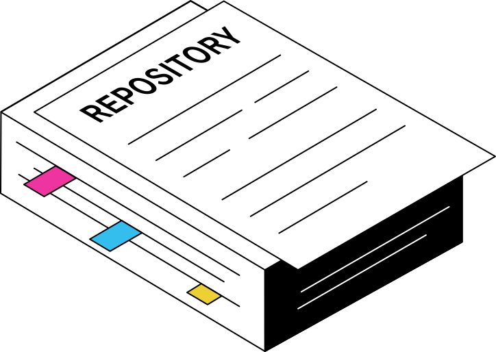

# Retrieving Information


<figure><figcaption><p>Welcome to my shop! The name's Open Shop Channel.</p></figcaption></figure>

If a client is written to support multiple repositories, it would be ideal if it could quickly receive general information about a given repository before connecting to it. This endpoint serves that purpose.

## Get Repository Information

<mark style="color:blue;">`GET`</mark> `/information`

Returns general repository information such as its name, the number of apps it provides, and the available categories.



```json
{
    "name": "Homebrew Apps",
    "provider": "Open Shop Channel",
    "description": "Open Shop Channel's homebrew apps repository.",
    "git_url": "https://github.com/OpenShopChannel/Apps.git",
    "available_apps_count": 242,
    "available_categories": [
        {
            "name": "demos",
            "display_name": "Demos",
            "singular": "demo",
            "plural": "demos"
        },
        {
            "name": "emulators",
            "display_name": "Emulators",
            "singular": "emulator",
            "plural": "emulators"
        },
        {
            "name": "games",
            "display_name": "Games",
            "singular": "game",
            "plural": "games"
        },
        {
            "name": "media",
            "display_name": "Media",
            "singular": "media application",
            "plural": "media applications"
        },
        {
            "name": "utilities",
            "display_name": "Utilities",
            "singular": "utility",
            "plural": "utilities"
        }
    ],
    "available_platforms": [
        {
            "name": "wii",
            "display_name": "Wii"
        },
        {
            "name": "vwii",
            "display_name": "vWii"
        },
        {
            "name": "wii_mini",
            "display_name": "Wii Mini"
        }
    ]
}
```



On the root level of the JSON response, the following fields are available:

<table data-full-width="true"><thead><tr><th width="217">Field</th><th width="412.3333333333333">Description</th><th>Type</th></tr></thead><tbody><tr><td>available_apps_count</td><td>Number of available applications. This number refers to successfuly indexed applications, and not the total amount of installed manifests.</td><td>Integer</td></tr><tr><td>available_categories</td><td>A list of application categories defined by this repository.</td><td>List of <a href="retrieving-information.md#category">Categories</a></td></tr><tr><td>available_platforms</td><td>A list of platforms this repository serves apps for.</td><td>List of <a href="retrieving-information.md#platforms">Platforms</a></td></tr><tr><td>description</td><td>The description of the repository, as defined in the repository.json file in repository root.</td><td>String</td></tr><tr><td>git_url</td><td>The source repository of the Repository Manager instance.</td><td>String</td></tr><tr><td>name</td><td>The display name of the repository, as defined in the repository.json file in repository root.</td><td>String</td></tr><tr><td>provider</td><td>The provider of the repository, as defined in the repository.json file in repository root.</td><td>String</td></tr></tbody></table>

### Category

<table><thead><tr><th width="196">Field</th><th width="413">Description</th><th>Type</th></tr></thead><tbody><tr><td>name</td><td>The internal name for the category, this is also the name to be used in manifests.</td><td>String</td></tr><tr><td>display_name</td><td>Human readable name of the category.</td><td>String</td></tr><tr><td>singular</td><td>Singular representation of the name.</td><td>String</td></tr><tr><td>plural</td><td>Plural representation of the name.</td><td>String</td></tr></tbody></table>

### Platforms

<table><thead><tr><th width="200">Field</th><th width="412">Description</th><th>Type</th></tr></thead><tbody><tr><td>name</td><td>The internal name for the platform, this is also the name to be used in manifests.</td><td>String</td></tr><tr><td>display_name</td><td>Human readable name of the platform.</td><td>String</td></tr></tbody></table>
