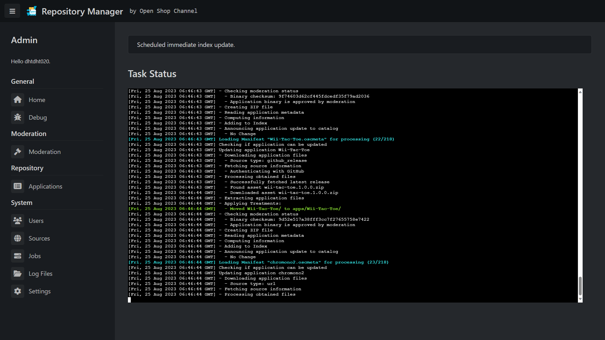

# Repository Index

<figure><figcaption>
Repository Manager Index
</figcaption></figure>

Indexing is a central aspect of the Repository Manager server.

The role of the repository indexing process is to perform the heavy and long process of collecting and processing all information about a given repository and storing it in-memory and inside a database, alongside files relevant to applications, so that the information contained in them can be accessed instantly and frequently when needed.

The repository indexing process usually runs four times per day in order to accomodate potential application updates, and always pulls latest changes from version control before it can start.

All files relevant to the repository index are contained in a "data" directory in the server's root.

When the server starts, it will attempt to generate an in-memory index, if application files are not available or the server has not been configured (first run) then it will stop the indexing and prompt the user to correct this.

The index is never directly exposed to the user and is only used internally. The only way to access the contents of the index externally is through the [API](broken-reference).

<figure><figcaption></figcaption></figure>
