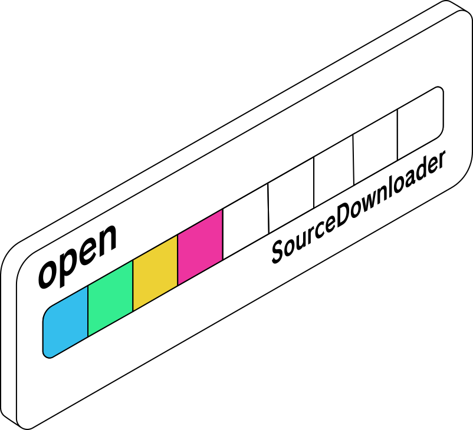

# SourceDownloader


<figure><figcaption><p>Downloading...</p></figcaption></figure>

Apps can be distributed on various different services, websites, and other potential sources. RepositoryManager is designed to support an infinite amount of them. How does it do it?

A `SourceDownloader` is a Java interface used represent instructions for how to obtain an application from a given source, implementing an abstract class `BaseSourceDownloader`.

All SourceDownloaders must be registered using the `SourceRegistry` object, when registered they become "installed sources" and used by the server during repository indexing.

The following is an example of a SourceDownloader:


```java
@Component // Needed so the server knows to instantiate this object automatically
public class ExampleDownloader extends BaseSourceDownloader
{
    @Autowired // Required to receive the registry object
    private ExampleDownloader(SourceRegistry registry)
    {
        // ID, Name, Description
        super("example", "Mysterious Source Downloader", "Downloads a bunch of stuff from somewhere!!");
        // Register the downloader
        registry.registerDownloader(this);
    }

    @Override
    protected Request fetchFileInformation(InstalledApp app, Path archivePath, Path tmpDir)
    {
        Request request = ...
        // Fetch source information for this source type
        // AKA, do all the work to identify the file to download,
        // then return a request for the file to be downloaded.
        return request;
    }

    @Override
    protected void processFiles(InstalledApp app, Path archivePath, Path tmpDir, Request request) throws IOException
    {
        // Process files for this source type
        // AKA, download the file to tmpDir.
    }
}
```

